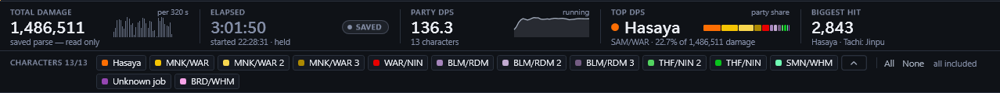

# Zerg

Zerg is a native Windows app (C#, WPF, .NET 10) that shows your party's damage
and healing in FFXI, live, as you play.


**Panels over the game.** Pop any card out into its own see-through panel and
lay it over FFXI. Panels stay on top, never take the keyboard from the game,
and can be made click-through (Ctrl+Alt+Z) so your mouse passes straight to
the game.



**The fight at a glance.** Total damage, party DPS, the top damage dealer and
the biggest hit, kept up to date as you play. Turn characters on and off with
one press.


**Every action.** Open any character to see each attack and weaponskill they
used, with hits, misses, total, average, min, max and its share of their
damage.


**Drill into one action.** Pick an action to see its average, median, spread
and accuracy, a chart of how its hits landed, and every single hit, with the
time and target.


**Who's ahead, and when.** A running total per character across the whole
fight, with small contributors grouped so the leaders stay readable.


**Where the damage came from, and where it went.** Damage by type (melee,
weaponskills, magic, pets, job abilities) and by target, with accuracy and
weaponskill figures per target, low accuracy marked. Select a target or a type
to isolate it, and everything else follows.


**Compare your runs.** Open two parses as A and B and every figure shows what
changed: damage, DPS, accuracy and weaponskills, for the party, each character
or each job, each target and each damage type.


**Action against action.** Open a character to compare each of their actions
between the two runs: uses, accuracy, average, max and total, each with its
change. Open an action to lay A's hits over B's on one chart, with the two
side by side on hits, median, average, 90th percentile, max, spread and crit
rate. Try a different weaponskill or a new set of gear and see exactly what it
was worth. You can even set one action against a different one.


**Replay any night.** Open an event file the addon wrote, even one you never
pressed Start for, and see its activity laid out across the whole file. Drag
the range to just the fight you want and every figure follows; export that
range as a parse to keep or compare.

**Keep your parses.** Export a session as a `.zerg` parse and open it again
later. Hide names before you share a screenshot.

## Requirement: the VibeXI addon

**Zerg needs the [VibeXI](https://github.com/HasayaFFXI/VibeXI) Ashita addon.**
The addon is Zerg's only data source: it reads the game's action packets and
writes one line per event to `%LOCALAPPDATA%\VibeXI\events\`, and Zerg reads
those files. Without the addon running in game, Zerg has nothing to show.

**Before using Zerg, install VibeXI by following the installation instructions
in the [VibeXI repository](https://github.com/HasayaFFXI/VibeXI).** Those
instructions are the authority on setting up the addon; this repository does
not repeat them.

## Getting Zerg

Download Zerg from the [latest release](https://github.com/HasayaFFXI/Zerg/releases/latest):
an installer, `Zerg-<version>-setup.exe`, or a zip with one `Zerg.exe` in
it (Windows 10 or 11, 64-bit; nothing else to install) and a `README.txt`
that says how to start. Both are made with `python tools/package.py` (the
installer needs Inno Setup 6: `winget install JRSoftware.InnoSetup`); a new
version merged to main is built and released by
`.github/workflows/release.yml`.

## Building from source

```
dotnet build Zerg.slnx
dotnet test Zerg.slnx
dotnet run --project src/Zerg
```

`CLAUDE.md` has the full development notes, `RULES.md` the event contract and
the reason behind every number Zerg prints, and `CHANGELOG.md` what each
version changed.

## License

Zerg is free software under the GNU General Public License, version 3: you
may share and change it under that license's terms. It comes with no
warranty. The full text is in [`LICENSE`](LICENSE).
