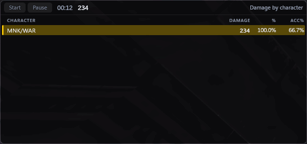
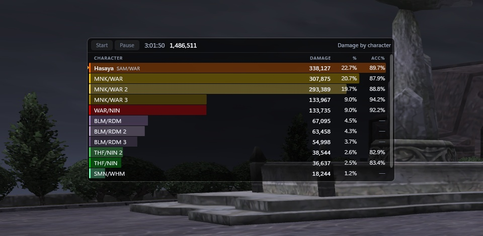
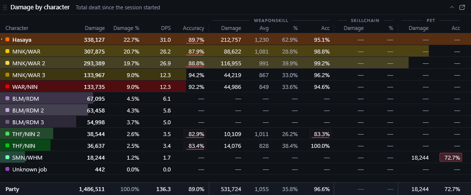
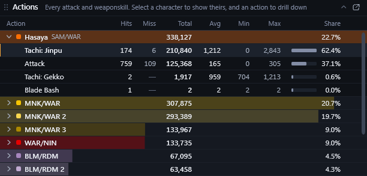
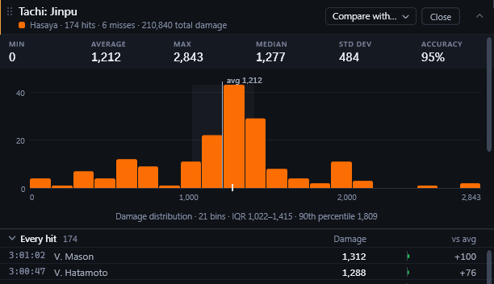
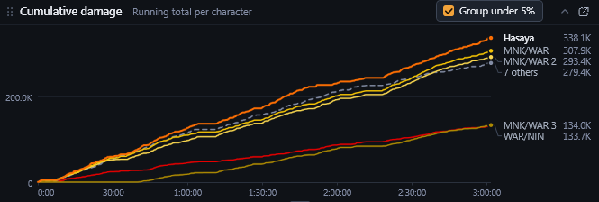
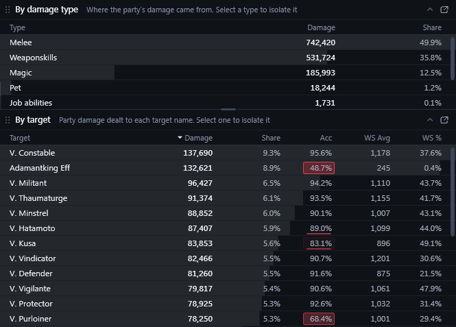
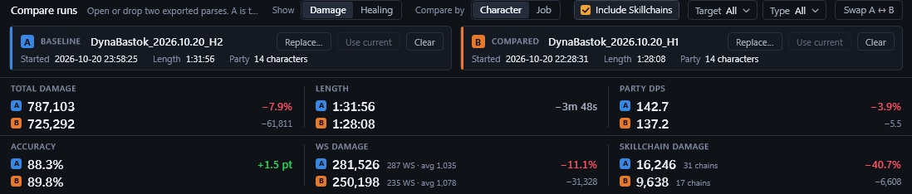
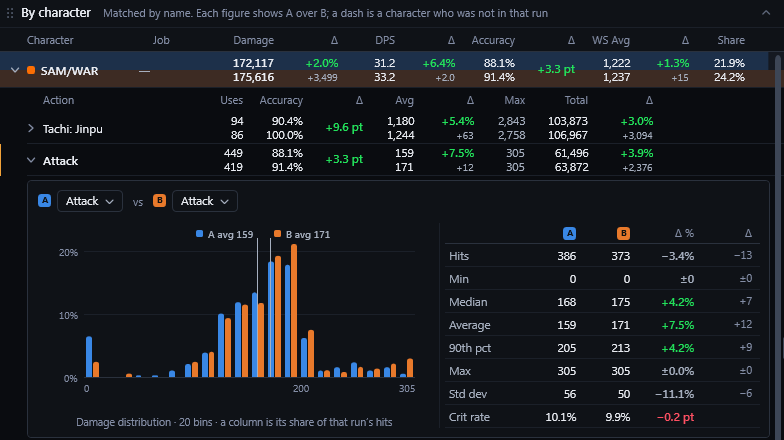
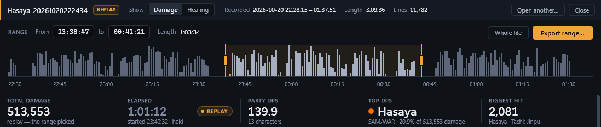

# Zerg

**Real-time damage and healing analysis for Final Fantasy XI.**

Zerg shows the damage, accuracy, weaponskills and healing of every character
in your party or alliance as the fight happens, in a desktop window or in
transparent panels over the game. Recorded sessions can be saved, reviewed,
compared and shared. Zerg is free and open source, for Windows 10 and 11.

**[Download the latest release](https://github.com/HasayaFFXI/Zerg/releases/latest)**
· requires the [VibeXI](https://github.com/HasayaFFXI/VibeXI) addon

## Getting started

1. **Install the VibeXI addon.** Zerg's data comes from VibeXI, an Ashita v4
   addon. Download `VibeXI-<version>.zip`
   from its [latest release](https://github.com/HasayaFFXI/VibeXI/releases/latest),
   unzip it into your Ashita folder, and load it in game with
   `/addon load vibexi`. The [VibeXI README](https://github.com/HasayaFFXI/VibeXI)
   has the full instructions, including its setting for your server.
2. **Install Zerg.** From the
   [latest release](https://github.com/HasayaFFXI/Zerg/releases/latest),
   download either:
   - `Zerg-<version>-setup.exe`, which installs Zerg for the current user
     (no administrator rights needed), or
   - the zip, a portable `Zerg.exe` that runs from any folder.

   Zerg is not code-signed, so Windows may show "Windows protected your PC".
   If it does, select **More info**, then **Run anyway**.
4. **Record a session.** Press **Start** in Zerg before the fight. The clock
   starts at the first hit that counts. Press **Pause** when the fight ends.
   Pressing Start during a session asks for confirmation first, so a
   recording is not discarded by accident.

## At a glance

- **Overlay panels.** Any view can be placed over the game as a transparent,
  always-on-top panel.
- **Session overview.** Total damage, Party DPS, the top contributor and the
  biggest hit. Each character's damage, share, DPS, accuracy, weaponskill,
  skillchain and pet figures are updated live.
- **Action and hit detail.** Every attack, weaponskill and spell, down to
  each individual hit, with its distribution.
- **Breakdowns by target and damage type.** Isolate a single target or type,
  and every other view recalculates to match.
- **Healing.** Each healer's output, every heal, and Party HPS.
- **Run comparison.** Compare two runs side by side, with the change in every
  figure, down to individual actions.
- **Replay.** Any event file VibeXI has recorded can be opened, narrowed to a
  time range and saved as a session.

## Features

### Overlay panels

Any pane can be popped out of the main window into its own panel and placed
over the game. Panels stay on top, are transparent at an adjustable opacity,
and never take keyboard focus from the game. A hot key (Ctrl+Alt+Z by
default, changeable in Settings) makes them click-through, so mouse input
passes to the game.

### Session overview

The band across the top summarises the session: total damage, elapsed time,
Party DPS, the top contributor and the biggest single hit.
Characters can be included or excluded with one press on their name.

### Per-character breakdown

Each character's damage, share of the total, DPS and accuracy,
followed by weaponskill, skillchain and pet figures, with a Party line that
totals them. Each row is shaded to the character's share of the leader.
Accuracy below a threshold you set is marked, which makes accuracy problems
visible at once.

### Action and hit detail

Expanding a character lists every action they used: hits, misses, total,
average, minimum, maximum and share of their damage.

Selecting an action opens its distribution: minimum, average, maximum,
median, standard deviation, accuracy, a histogram of every hit, and a list of
each hit with its time, target and difference from the average. Two actions
can be opened side by side, from the same character or from two characters,
to compare them on one chart.

### Damage over time

Each character's running total across the session. Characters below 5 % of
the total can be grouped into one line so the leading lines stay legible.

### Damage by type and by target

Damage is broken down by type (melee, weaponskills, magic, pets, job
abilities, skillchains) and by target. Each target also shows the overall
accuracy against it and its weaponskill figures. Selecting a target or a type
isolates it, and every other view recalculates. Use this to evaluate a single
enemy, or to see how much of the damage came from weaponskills.

### Healing

Healing is tracked the same way as damage, in its own section:
- **Healing by character**: each character's healing, casts and average,
  with pets' healing in a separate column.
- **Heals**: every cure, waltz and pet heal per character, each with its own
  drill-down.
- **Cumulative healing**.

Its summary band shows total healing, Party HPS, the top healer and the
biggest heal.

### Run comparison

Load two sessions as A and B, saved or in progress, and every figure shows
the change from A to B, for damage or healing: by character or job, target
and damage type.

Open an action to see both runs' hits on one histogram, with their
statistics side by side: the measure of a change in equipment or
weaponskill.

Any two actions can be paired, in one session or across two, such as one
weaponskill against another.

### Replay of recorded sessions

Any event file VibeXI has written can be opened in full, including sessions
for which Start was never pressed. Its damage is plotted across the whole
file. Drag the range handles, or type the times, to select one fight; every
figure is recalculated for that range, which can be exported as a saved
session.

### Saved sessions and sharing

- **Saving.** A paused session can be exported as a `.zerg` file. Each file
  opened gets its own tab, so several sessions can be reviewed at once.
- **Opening.** `.zerg` files open with a double-click once the file
  association is set (the installer offers it), or by dropping them onto
  Zerg.
- **Sharing.** A `.zerg` file can be sent to anyone who uses Zerg.
- **Privacy.** **Hide names** replaces character names with their jobs, for
  screenshots and recordings.

### Layout and display

- **Panes.** Every pane can be resized, folded, moved or popped out. Zerg
  remembers the arrangement of each section, and it can be locked.
- **Sorting.** The character, action, heal, target, damage type and hit
  tables sort by any column heading.
- **Theme.** Light and dark themes.
- **Skillchains.** Skillchain damage can be included or left out.

## License

Zerg is free software under the GNU General Public License, version 3: you
may share and change it under that license's terms. It comes with no
warranty. The full text is in [`LICENSE`](LICENSE).
